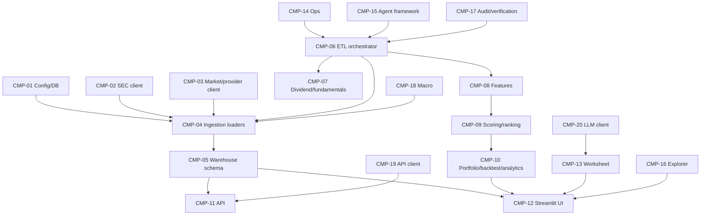

# Component Catalog

| Field | Value |
|---|---|
| Stage | 0 — Discovery |
| Scope | Code components with stable IDs (CMP-) |
| Method | Read-only static inspection of `src/`, `scripts/`, `api/`, `app/`, `sql/` |
| Legend | V = Verified, I = Inferred, A = Assumption, U = Unknown |
| Row format | ID \| Finding \| Evidence \| File path \| Function/Class \| Requirement ID \| CRISP-DM phase \| Risk \| Recommended action \| Confidence \| Type |

## 1. Component Register (CMP-)

| ID | Component | Responsibility | Key evidence | Conf/Type |
|---|---|---|---|---|
| CMP-01 | Configuration & DB foundation | Settings, engine, execute/read helpers, retry/throttle primitives | `src/crispdm/config.py` `Settings`; `src/crispdm/db.py` `engine`, `execute`, `read_df`; `src/crispdm/http_retry.py` `Throttle`, `request_with_backoff` | 0.98 V |
| CMP-02 | SEC EDGAR client | Ticker/CIK mapping, submissions, companyfacts/concepts, filing archives, XBRL classification | `src/crispdm/sec_client.py` `SEC_SESSION`, `get_company_tickers`, `get_submissions`, `get_companyfacts`, `fetch_archive_index` | 0.98 V |
| CMP-03 | Market/provider client | OpenBB SDK access; direct FMP/Polygon REST; Yahoo fallback; split/dividend reconciliation | `src/crispdm/openbb_client.py` `from openbb import obb`, `import yfinance as yf`, `FMP_DIVIDENDS_URL`, `POLYGON_DIVIDENDS_URL`, `FMP_DCF_URL`, `dividend_providers`, `reconcile_amounts`, `_price_basis_adjust` | 0.97 V |
| CMP-04 | Ingestion loaders | Raw/reference/clean/fundamentals/market/dividend loaders, bulk SEC ingestion, corporate actions | `scripts/populate_*.py`, `scripts/load_*.py`, `scripts/load_sec_bulk.py`, `scripts/build_historical_universe.py` | 0.95 V |
| CMP-05 | Warehouse schema & migrations | Relational model, forward-only versioned migrations, schema drift checks | `sql/schema.sql` (9 schemas); 104 `sql/migrations/V*.sql` files; max applied version 106; `scripts/init_db.py`, `scripts/migrate.py`, `scripts/check_schema_drift.py` | 0.98 V |
| CMP-06 | ETL orchestrator | Ordered stage execution, advisory lock, migration preflight, audit recording | `scripts/run_full_etl.py` `main`, `run_module`, `PIPELINE_LOCK_KEY=4_713_155_001`, `SUPPORTING_LOADERS`, `BULK_EDGAR_LOADER` | 0.98 V |
| CMP-07 | Dividend universe & fundamentals | Dividend classification, XBRL tag mapping, periodic financial extraction, preferred/common limits | `src/crispdm/dividend_universe.py`, `fundamentals.py`, `xbrl_tags.py`, `dividend_limits.py`; `scripts/populate_fundamentals.py` | 0.92 V |
| CMP-08 | Feature engineering | Declared model feature set, point-in-time feature window, feature insert/upsert | `src/crispdm/features.py`; `feature_set.py` `FEATURES`; `feature_window.py`; `scripts/build_features.py`; `model.features` | 0.95 V |
| CMP-09 | Scoring & ranking | Percentile factor blends, composite scores, predictions, rankings | `src/crispdm/scoring.py` `WEIGHTS`, `pct`, `score`, `predictions`, `rankings`; `scripts/score_rank.py` | 0.98 V |
| CMP-10 | Portfolio, backtest & analytics | Risk-parity book, walk-forward backtest, baselines, regimes, analogs, event study, returns | `src/crispdm/portfolio.py`, `backtest.py`, `baselines.py`, `regime.py`, `regime_pipeline.py`, `analogs.py`, `event_study.py`, `returns.py`; `src/math_engine.py` | 0.95 V |
| CMP-11 | FastAPI data API | Read API for SEC/OpenBB/warehouse data; API-key auth; rate limiting | `api/main.py` routes; `require_api_key`; `_SlidingWindowLimiter`; `_openbb_call` | 0.98 V |
| CMP-12 | Streamlit analyst UI | Screener, security detail, worksheet, dashboard, explorer, health, ops, integrations | `app/streamlit_app.py` `PAGES`; `app/views/*.py`; `app/nav.py`; `app/ui.py` | 0.98 V |
| CMP-13 | Investment-analysis worksheet | 18-section workflow, validation, autofill, persistence, revisions | `app/views/investment_analysis.py`; `app/analysis_schema.py` `SECTIONS`; `app/analysis_autofill.py`; `src/crispdm/analysis/store.py`; `analysis.investment_analyses` | 0.96 V |
| CMP-14 | Ops control plane | Allowlisted task catalog, queue, scheduling, worker, execution, operator auth | `src/crispdm/ops/catalog.py` `CATALOG`; `ops/runner.py`, `ops/store.py`, `ops/schedule.py`, `ops/auth.py`; `scripts/ops_worker.py` | 0.98 V |
| CMP-15 | Agent/skill framework | Skill validation, tool registry, deterministic runner, run artifacts | `scripts/agent_runner.py`; `src/agent/core/loader.py`; `src/agent/schemas/skill.py`; `src/agent/tools/*`; `SYSTEM.md`; `skills/` | 0.95 V |
| CMP-16 | Data explorer | Allowlisted relation browser; read-only transaction; parameterized filters | `src/crispdm/explorer.py` `Dataset`, `build_query`, `run_query` (`SET TRANSACTION READ ONLY`); `app/views/data_explorer.py` | 0.93 V |
| CMP-17 | Nightly verification & audit | Run-health, freshness, model-gate, schema-drift checks; audit tables | `scripts/verify_nightly_run.py`, `scripts/post_nightly_check.py`, `scripts/populate_audit.py`; `audit.*` | 0.95 V |
| CMP-18 | Macro inputs & vintages | Macro series registry, provider routing, vintage ingestion, memo rendering | `src/crispdm/macro_inputs.py` `PROVIDER_ROUTES`; `macro_vintages.py`; `scripts/populate_macro_inputs.py`, `load_macro_vintages.py` | 0.94 V |
| CMP-19 | Internal API client | Allowlisted Streamlit→API calls; ticker validation; key handling | `src/crispdm/api_client.py` `ENDPOINTS`, `ApiClient`; `app/views/integrations.py` | 0.95 V |
| CMP-20 | Local LLM draft client | Optional OpenAI-compatible chat client to prefill worksheet drafts; loopback-only default | `app/llm_client.py` `generate_draft`, `_post`; `Settings.llm_enabled/endpoint/model` | 0.97 V |

## 2. Component Interaction (high level)

## 3. Findings Register

| ID | Finding | Evidence | File path | Function/Class | Requirement ID | CRISP-DM phase | Risk | Recommended action | Confidence | Type |
|---|---|---|---|---|---|---|---|---|---|---|
| CMP-F01 | ETL is one sequential Python orchestrator invoking modules via subprocess | `subprocess.run([sys.executable, "-m", name, *args])` | `scripts/run_full_etl.py` | `run_module` | TBD | Data Preparation | Med | Keep stage contract; add per-stage timeout/idempotency docs | 0.98 | Verified |
| CMP-F02 | Pipeline serializes concurrent runs with a Postgres advisory lock | `PIPELINE_LOCK_KEY = 4_713_155_001`; `PipelineAlreadyRunning` | `scripts/run_full_etl.py` | `main` | TBD | Data Preparation | High | Add test for lock contention; document exit code 2 | 0.98 | Verified |
| CMP-F03 | Production ranking is deterministic rule-based percentile scoring, not the ML model | `WEIGHTS` five factors; `model_version="rule_scoring_v1"` | `src/crispdm/scoring.py` | `score`, `predictions`, `rankings` | TBD | Modeling | High | Document model-vs-scoring split; keep ML gated | 0.98 | Verified |
| CMP-F04 | Scoring requires minimum 50% factor weight coverage before publishing | `MIN_PRESENT_WEIGHT = 0.50` | `src/crispdm/scoring.py` | `score` | TBD | Modeling | Med | Add boundary tests for coverage threshold | 0.98 | Verified |
| CMP-F05 | ML classifier is scikit-learn LogisticRegression with fixed `random_state=42` and walk-forward gates | `LogisticRegression(random_state=42)`; gate constants | `src/crispdm/model.py` | `walk_forward`, `evaluate_gate` | TBD | Modeling | Med | Keep seed fixed; record model version per run | 0.95 | Verified |
| CMP-F06 | Several ML features are explicitly placeholders | `PLACEHOLDER_FEATURES` | `src/crispdm/model.py` | `PLACEHOLDER_FEATURES` | TBD | Data Preparation | High | Resolve placeholders before any ML adoption | 0.95 | Verified |
| CMP-F07 | Feature store is point-in-time quarterly vintages | quarterly vintages, TTM ratios, filed-date handling | `src/crispdm/features.py` | `build_features` | TBD | Data Preparation | High | Verify as-of semantics in Stage 1B | 0.95 | Verified |
| CMP-F08 | Dividend rows are reconciled across FMP/Yahoo/Polygon and restated to split basis | `dividend_providers`, `reconcile_amounts`, `_price_basis_adjust` | `src/crispdm/openbb_client.py` | `reconcile_amounts` | TBD | Data Preparation | Critical | Verify formulas in Stage 1A | 0.98 | Verified |
| CMP-F09 | Raw market data stores no adjusted close; adjustment is reconstructed downstream | `adjusted_close` 100% NULL (0 of 9,823,774 rows) | `sql/schema.sql`; `raw.market_data` | — | TBD | Data Preparation | Critical | Formalize adjustment factor lineage in Stage 1A | 1.0 | Verified |
| CMP-F10 | Ops worker executes only catalog-listed modules with coerced parameters | fixed module names; no shell strings | `src/crispdm/ops/catalog.py` | `CATALOG`, `TaskDef` | TBD | Deployment | High | Add catalog review checklist; negative tests | 0.98 | Verified |
| CMP-F11 | Explorer enforces read-only transactions and bounded result sizes | `SET TRANSACTION READ ONLY`; `MAX_ROWS=5000` | `src/crispdm/explorer.py` | `run_query` | TBD | Deployment | Med | Keep allowlist; add injection regression tests | 0.93 | Verified |
| CMP-F12 | Audit components record lineage, quality, quarantine, freshness, and run history | `audit.source_lineage`, `data_quality`, `quarantined_values`, `nightly_runs` | `scripts/populate_audit.py`; `scripts/verify_nightly_run.py` | `populate_audit` | TBD | Evaluation | High | Use as basis for auditability requirements | 0.95 | Verified |
| CMP-F13 | Schema has 104 migration files but max applied version is 106; ledger has 105 rows | `schema_migrations` max(version)=106 | `sql/migrations/` | — | TBD | Data Preparation | Med | Reconcile version numbering documentation | 1.0 | Verified |
| CMP-F14 | `sql/silver_schema.sql` is an unused alternate star schema | no runtime references found | `sql/silver_schema.sql` | — | TBD | Data Preparation | Low | Archive or document as non-canonical | 0.90 | Inferred |
| CMP-F15 | Worksheet LLM path is optional but module docstring says no model is called | docstring "Nothing here calls a model" vs `generate_draft` call | `app/views/investment_analysis.py` | `_generate_section` | TBD | Deployment | Low | Correct docstring | 0.98 | Verified |
| CMP-F16 | Documentation overstates architecture (dbt, Bayesian/Markov, multi-agent) relative to code | target design vs no matching modules | `README.md`; `TECHNICAL_SPEC.md`; `docs/UiWorkflowArchitecture.md` | — | TBD | Business Understanding | Med | Mark aspirational sections explicitly | 0.90 | Verified |
