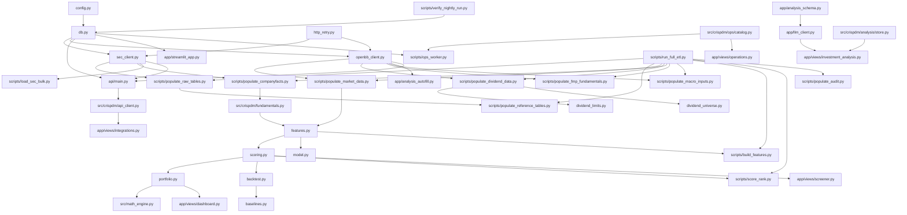

# Dependency Graph and Third-Party Dependencies

| Field | Value |
|---|---|
| Stage | 0 — Discovery |
| Scope | Internal module dependencies + third-party packages with versions |
| Method | Import/symbol inspection; `git show HEAD:requirements.txt`; `requirements-dev.txt`; local `.venv` inventory |
| Legend | V = Verified, I = Inferred, A = Assumption, U = Unknown |
| Row format | ID \| Finding \| Evidence \| File path \| Function/Class \| Requirement ID \| CRISP-DM phase \| Risk \| Recommended action \| Confidence \| Type |

## 1. Internal Dependency Graph (high level)

## 2. Runtime Dependencies (pinned at HEAD `d748cea`)

| Package | Version (HEAD) | Used by | Evidence | Conf/Type |
|---|---|---|---|---|
| openbb | 4.7.2 | `src/crispdm/openbb_client.py`, provider aggregation | `requirements.txt`; `from openbb import obb` | 0.97 V |
| yfinance | 1.7.0 | Price/dividend fallback, preferred utility | `openbb_client.py`; `scripts/yahoo_FetchPreferredStock.py` | 0.97 V |
| pandas | 2.3.3 | All data transforms | Repo-wide | 0.99 V |
| numpy | 2.2.6 | Numeric operations, RNG in dry-run/tests | Repo-wide | 0.98 V |
| sqlalchemy | 2.0.54 | DB engine/reads/writes | `src/crispdm/db.py` | 0.99 V |
| psycopg[binary] | 3.3.6 | PostgreSQL driver | `src/crispdm/config.py` | 0.98 V |
| pydantic-settings | 2.15.0 | `Settings` | `src/crispdm/config.py` | 0.98 V |
| python-dotenv | 1.2.3 | `.env` loading | `src/crispdm/config.py` | 0.97 V |
| scikit-learn | 1.7.2 | ML classifier pipeline | `src/crispdm/model.py` | 0.97 V |
| joblib | 1.6.0 | Model persistence | `src/crispdm/model.py` | 0.95 V |
| requests | 2.34.2 | HTTP providers | `sec_client.py`, `http_retry.py`, `llm_client.py` | 0.98 V |
| beautifulsoup4 | 4.15.0 | Filing/HTML parsing | `sec_client.py`, contract terms | 0.95 V |
| lxml | 6.1.3 | XML/HTML parsing | SEC parsing | 0.95 V |
| defusedxml | 0.7.1 | Safe XML parsing | SEC parsing | 0.95 V |
| pyarrow | 25.0.1 | Parquet support | Installed; no Parquet storage found | 0.90 V |
| plotly | 7.1.0 | Streamlit charts | `app/views/*` | 0.97 V |
| streamlit | 1.64.0 | Analyst UI | `app/streamlit_app.py` | 0.99 V |
| fastapi | 0.136.3 | Data API | `api/main.py` | 0.99 V |
| uvicorn[standard] | 0.40.0 | API server | `Dockerfile` | 0.98 V |
| jinja2 | 3.1.6 | Templating (indirect/streamlit) | HEAD requirements | 0.90 V |

## 3. Development/CI Dependencies

| Package | Version | Purpose | Evidence | Conf/Type |
|---|---|---|---|---|
| pytest | 8.4.2 | Test runner (1,929 tests collected) | `requirements-dev.txt`; `.github/workflows/ci.yml` | 0.99 V |
| ruff | 0.15.22 | Lint + format | `requirements-dev.txt`; `.github/workflows/ci.yml` | 0.99 V |
| pip-audit | 2.10.1 | Dependency vulnerability audit | `requirements-dev.txt`; CI security job | 0.98 V |

## 4. Declared but Unused / Optional Dependencies

| Package | Status | Evidence | Conf/Type |
|---|---|---|---|
| langchain, langgraph, ollama | Present in `requirements.txt`; no imports in `src/`, `scripts/`, `app/`, `api/` | Import scan; `opencode.json`/`Modelfile` are dev tooling | 0.90 V |
| airflow, pendulum | Not in runtime requirements; Airflow DAG is optional bring-your-own | `airflow/dags/dividend_etl_dag.py` | 1.0 V |
| pymc, scipy.stats, Markov/HMM libraries | Not present; `TECHNICAL_SPEC.md` describes them as target design | `TECHNICAL_SPEC.md`; dependency scan | 0.90 V |
| dbt | Not present; README claims it | `README.md`; no dbt files | 0.90 V |

## 5. Dependency and Reproducibility Findings

| ID | Finding | Evidence | File path | Function/Class | Requirement ID | CRISP-DM phase | Risk | Recommended action | Confidence | Type |
|---|---|---|---|---|---|---|---|---|---|---|
| DEP-F01 | Working-tree `requirements.txt` is fully unpinned (238 lines, 0 `==`), while HEAD pins 20 direct deps | `grep -c '==' requirements.txt` → 0; uncommitted modification | `requirements.txt` | — | NFR determinism | Deployment | Critical | Revert or commit intentional pin strategy; add lockfile | 1.0 | Verified |
| DEP-F02 | No lockfile or project metadata (no `pyproject.toml`, `poetry.lock`, `uv.lock`, `Pipfile`) | repo-wide search | — | — | NFR reproducibility | Deployment | High | Adopt a lock mechanism (uv/pip-tools) | 1.0 | Verified |
| DEP-F03 | Local interpreter is Python 3.11.0rc1; Docker/CI use 3.12; README claims 3.10-3.14 | version checks | `.venv`; `Dockerfile`; `README.md` | — | NFR reproducibility | Deployment | High | Pin one supported Python version | 1.0 | Verified |
| DEP-F04 | Installed tool drift: pytest 9.1.1 vs pin 8.4.2; streamlit 1.67.0 vs pin 1.64.0; pip-audit missing locally | `.venv/bin/pip list` | `requirements-dev.txt` | — | NFR reproducibility | Deployment | Med | Recreate venv from pinned files | 1.0 | Verified |
| DEP-F05 | Dockerfile adds floating override `pillow>=13.0.0` | `pip install "pillow>=13.0.0"` | `Dockerfile` | — | NFR reproducibility | Deployment | Med | Pin pillow explicitly | 1.0 | Verified |
| DEP-F06 | `pyarrow` is installed but no Parquet usage was found | dependency present; storage search found no Parquet | `requirements.txt` | — | NFR maintainability | Data Preparation | Low | Remove or document future use | 0.90 | Inferred |
| DEP-F07 | Declared AI libs (`langchain`, `langgraph`, `ollama`) are unused by application code | import scan | `requirements.txt` | — | NFR maintainability | Deployment | Low | Remove unused deps | 0.90 | Verified |
| DEP-F08 | SEC/OpenBB clients are tightly coupled to scripts via imports; no formal interface layer | direct imports across scripts | `scripts/populate_*.py` | — | NFR testability | Data Preparation | Med | Introduce provider interface for testability | 0.90 | Inferred |
| DEP-F09 | `openbb` plus 30+ provider packages create a large, drift-prone dependency surface | OpenBB provider list | `requirements.txt` | — | NFR reliability | Deployment | High | Pin provider set; audit upgrades | 0.95 | Verified |
| DEP-F10 | CI action refs and Postgres image are tag-pinned, not SHA/digest-pinned | `actions/checkout@v4`; `postgres:17.11` | `.github/workflows/ci.yml` | — | NFR reproducibility | Deployment | Med | Pin by SHA/digest | 1.0 | Verified |
