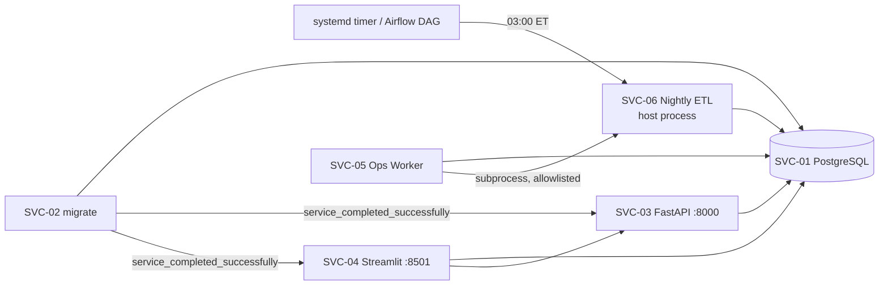

# Service Inventory

| Field | Value |
|---|---|
| Stage | 0 — Discovery |
| Scope | Runtime services, jobs, schedulers (SVC-) |
| Method | Read `docker-compose.yml`, `Dockerfile`, `ops/systemd/`, `airflow/`, `scripts/`, `api/`, `app/` |
| Legend | V = Verified, I = Inferred, A = Assumption, U = Unknown |
| Row format | ID \| Finding \| Evidence \| File path \| Function/Class \| Requirement ID \| CRISP-DM phase \| Risk \| Recommended action \| Confidence \| Type |

## 1. Service Register (SVC-)

| ID | Service | Invocation / runtime | Interfaces & dependencies | Evidence | Conf/Type |
|---|---|---|---|---|---|
| SVC-01 | PostgreSQL warehouse | Compose service `postgres`; `postgres:17.11@sha256:…`; persistent `pgdata` | `127.0.0.1:5432`; DB/user `dividend`; init from `sql/schema.sql`; `pg_isready` healthcheck | `docker-compose.yml` `services.postgres` | 0.99 V |
| SVC-02 | Migration job | One-shot Compose service `migrate`; `python -m scripts.migrate` | Postgres only; waits for healthy DB; read-only rootfs | `docker-compose.yml` `services.migrate`; `scripts/migrate.py` | 0.98 V |
| SVC-03 | FastAPI data API | Compose service `api`; `uvicorn api.main:app --host 0.0.0.0 --port 8000` | `127.0.0.1:8000`; `API_KEY` required; Postgres, SEC, OpenBB; `/health` public | `docker-compose.yml`; `api/main.py` | 0.99 V |
| SVC-04 | Streamlit analyst app | Compose service `streamlit`; `streamlit run app/streamlit_app.py --server.address=0.0.0.0 --server.port=8501` | `127.0.0.1:8501`; Postgres; `OPS_ADMIN_TOKEN`; `API_BASE_URL`/`API_KEY`; credentials bind mount | `docker-compose.yml`; `app/streamlit_app.py` | 0.99 V |
| SVC-05 | Operations worker | Compose service `worker`; `python -m scripts.ops_worker` | Postgres `ops.*` queue; catalog allowlist; no published port | `docker-compose.yml`; `scripts/ops_worker.py` | 0.98 V |
| SVC-06 | Nightly ETL job | Host process `python -m scripts.run_full_etl`; systemd timer or Airflow DAG | Postgres + SEC/OpenBB/FMP/FRED/Yahoo/Polygon/Nasdaq; not scheduled by Compose | `ops/systemd/dividend-etl.{service,timer}`; `airflow/dags/dividend_etl_dag.py`; `docs/deployment-runbook.md` | 0.98 V |
| SVC-07 | Schema bootstrap | `python -m scripts.init_db` | Applies `sql/schema.sql`; used by CI before migrations | `scripts/init_db.py`; `.github/workflows/ci.yml` | 0.90 V |
| SVC-08 | Agent/skill runner | `python -m scripts.agent_runner --skill …` | Fixed `scripts.*` entrypoints, Postgres preflight, git status, `artifacts/runs/` | `scripts/agent_runner.py`; `docs/file-based-agentic-workflow.md` | 0.95 V |
| SVC-09 | Nightly verification CLI | `python -m scripts.verify_nightly_run` | Reads audit tables; exit 1 = attention needed | `scripts/verify_nightly_run.py`; `docs/nightly-verification.md` | 0.95 V |
| SVC-10 | Optional Airflow scheduler | DAG `dividend_equity_nightly_etl` | 03:00 America/New_York; subprocess invocation; Airflow not in runtime requirements | `airflow/dags/dividend_etl_dag.py` | 0.92 V |
| SVC-11 | CI pipeline | GitHub Actions on push to `main` and all PRs | Lint (ruff), tests (pytest + Postgres 17.11 service), dependency audit + gitleaks | `.github/workflows/ci.yml` | 0.98 V |

## 2. Runtime Topology

## 3. Runtime Detail

| Item | Fact | Evidence | Conf/Type |
|---|---|---|---|
| Compose services | `postgres`, `migrate`, `streamlit`, `api`, `worker` | `docker-compose.yml` | 0.99 V |
| Port binding | All published ports bound to `127.0.0.1` | `docker-compose.yml` | 0.99 V |
| Migration gating | UI/API wait for `service_completed_successfully` on `migrate` | `docker-compose.yml` | 0.98 V |
| API hardening | Non-root UID 10001, read-only rootfs, tmpfs for OpenBB, `cap_drop: ALL` | `Dockerfile`; `docker-compose.yml` | 0.98 V |
| ETL lock | Advisory lock; exit 2 if another run holds it | `scripts/run_full_etl.py` | 0.98 V |
| ETL run audit | Per-stage status/timing in `audit.nightly_runs`; best-effort recording | `scripts/run_full_etl.py` | 0.98 V |
| Migrations preflight | `migrate --check` refuses start if pending | `scripts/run_full_etl.py`; `scripts/migrate.py` | 0.98 V |
| systemd timer | `OnCalendar=*-*-* 03:00:00 America/New_York`, `Persistent=true` | `ops/systemd/dividend-etl.timer` | 0.98 V |
| systemd service | `Type=oneshot`, `TimeoutStartSec=12h`, `MemoryMax=8G`, `User=drelo` | `ops/systemd/dividend-etl.service` | 0.98 V |
| Airflow DAG | `schedule_interval="0 3 * * *"`, `catchup=False`, 2 retries, 10-min delay | `airflow/dags/dividend_etl_dag.py` | 0.95 V |
| Worker loop | Polls every 5 s; one task at a time; schedules enqueue due tasks | `scripts/ops_worker.py` `loop_once` | 0.98 V |
| Ops scheduler semantics | `once`/`interval`/`daily`; DST-aware; missed slots fire once, no stacking | `src/crispdm/ops/schedule.py`; `ops/store.py` | 0.98 V |
| Nightly verification cadence | Documented daily 09:00 ET check after 03:00 ET run | `docs/nightly-verification.md` | 0.97 V |

## 4. Current Operating State (live DB, 2026-11-15)

| Item | Fact | Evidence | Conf/Type |
|---|---|---|---|
| Last successful nightly run | Run 56 on 2026-11-09 | `audit.nightly_runs` (53 rows total) | 1.0 V |
| Failed runs 57-58 | `populate_reference_tables` failed | `audit.nightly_runs` | 1.0 V |
| Failed runs 59-60 | `populate_market_data` failed; run 60 took ~4.9 h before failing | `audit.nightly_runs` | 1.0 V |
| Market data freshness | Max observation date 2026-11-09, consistent with last success | `raw.market_data` | 1.0 V |
| Last freshness verification | 2026-11-04 for 12 sources; all within SLA | `audit.source_freshness` | 1.0 V |
| Open checks | JSM ticker/CIK conflict; ML walk-forward `NO-GO` | `audit.nightly_checks` | 1.0 V |

## 5. Findings Register

| ID | Finding | Evidence | File path | Function/Class | Requirement ID | CRISP-DM phase | Risk | Recommended action | Confidence | Type |
|---|---|---|---|---|---|---|---|---|---|---|
| SVC-F01 | Nightly ETL is not a Compose service and must be scheduled externally | "not scheduled by docker-compose.yml" | `docs/deployment-runbook.md`; `docker-compose.yml` | — | TBD | Deployment | High | Document both schedulers; add runbook drift check | 0.98 | Verified |
| SVC-F02 | systemd units hard-code checkout path and `User=drelo` | `ExecStart=…/dividend_equity_crispdm/.venv/bin/python`; `User=drelo` | `ops/systemd/dividend-etl.service` | — | TBD | Deployment | Med | Templatize units for portability | 1.0 | Verified |
| SVC-F03 | Airflow is optional and absent from runtime requirements | no `airflow`/`pendulum` in requirements | `airflow/dags/dividend_etl_dag.py`; `requirements.txt` | — | TBD | Deployment | Low | Document Airflow as bring-your-own | 1.0 | Verified |
| SVC-F04 | Last four nightly runs failed; warehouse is stale since 2026-11-09 | runs 57-60 failed | `audit.nightly_runs` | — | TBD | Evaluation | Critical | Investigate `populate_reference_tables` and `populate_market_data` failures | 1.0 | Verified |
| SVC-F05 | ETL records stage failures but not root-cause diagnostics | only stage names/exit codes stored | `audit.nightly_runs` | — | TBD | Deployment | High | Persist last error/log excerpt per stage | 1.0 | Verified |
| SVC-F06 | Worker executes tasks serially (one at a time) | `loop_once` single claim | `scripts/ops_worker.py` | `loop_once` | TBD | Deployment | Med | Document throughput limits; monitor queue depth | 0.98 | Verified |
| SVC-F07 | CI provisions Postgres but runs bare `pytest -q` with no coverage gate | `python -m pytest -q` | `.github/workflows/ci.yml` | — | TBD | Evaluation | High | Add coverage config and threshold (see Stage 1C) | 1.0 | Verified |
| SVC-F08 | CI action refs use tags, not commit SHAs; CI Postgres uses tag not digest | `actions/checkout@v4`; `postgres:17.11` | `.github/workflows/ci.yml` | — | TBD | Deployment | Med | Pin actions by SHA and image by digest | 1.0 | Verified |
| SVC-F09 | Postgres is loopback-bound and digest-pinned | `127.0.0.1:5432`; `@sha256:` | `docker-compose.yml` | `services.postgres` | TBD | Deployment | Low | Preserve; add upgrade procedure | 0.99 | Verified |
| SVC-F10 | No deployment/CD job exists | only lint/test/security jobs | `.github/workflows/ci.yml` | — | TBD | Deployment | Med | Define release workflow before production use | 1.0 | Verified |
| SVC-F11 | Agent runner is deterministic, fixed-entrypoint, artifact-producing | `--skill`, `--dry-run`, `--verify`; `artifacts/runs/<run-id>/` | `scripts/agent_runner.py` | `main` | TBD | Deployment | Low | Keep runner non-autonomous; document skill contract | 0.95 | Verified |
| SVC-F12 | Migrate job is one-shot and gates app start; no rollback migrations | forward-only migrations | `scripts/migrate.py`; `sql/migrations/` | — | TBD | Data Preparation | High | Document rollback strategy; test restore path | 0.98 | Verified |
