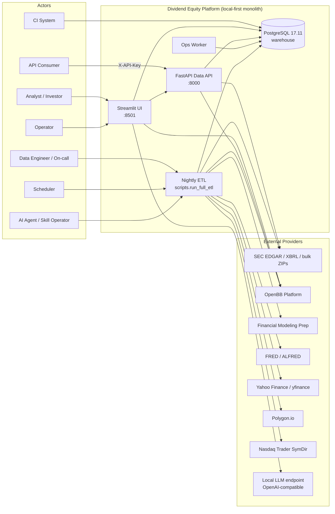

# System Context Map

| Field | Value |
|---|---|
| Stage | 0 — Discovery |
| Scope | Actors, external providers, integrations |
| Method | Read-only static inspection + read-only live PostgreSQL queries (2026-11-15) |
| Repo HEAD | `d748cea` |
| Legend | V = Verified (code/config read), I = Inferred, A = Assumption, U = Unknown |
| Row format | ID \| Finding \| Evidence \| File path \| Function/Class \| Requirement ID \| CRISP-DM phase \| Risk \| Recommended action \| Confidence \| Type |

## 1. Context Diagram

## 2. Actors (ACT-)

| ID | Actor | Goal | Touchpoints | Evidence | Conf/Type |
|---|---|---|---|---|---|
| ACT-01 | Analyst / investor | Screen dividend payers, inspect securities, complete thesis worksheet, review model portfolio and reports | Streamlit: Screener, Security detail, Investment analysis, Dashboard | `app/streamlit_app.py` `PAGES`; `app/views/{screener,security,investment_analysis,dashboard}.py` | 0.97 V |
| ACT-02 | Operator | Queue/cancel/schedule ops tasks, call API, inspect integrations | Streamlit sidebar sign-in (`OPS_ADMIN_TOKEN`), Operations page | `app/ui.py` `operator_panel`; `app/views/operations.py`; `src/crispdm/ops/auth.py` | 0.97 V |
| ACT-03 | API consumer | Read company/filing/financial/OpenBB/metrics data programmatically | HTTP `X-API-Key`, FastAPI routes | `api/main.py` `require_api_key`; `src/crispdm/api_client.py` `ENDPOINTS` | 0.96 V |
| ACT-04 | Data engineer / on-call | Run/repair ETL, migrate, verify nightly health, backfill | CLIs: `run_full_etl`, `migrate`, `init_db`, `verify_nightly_run`, loaders | `scripts/run_full_etl.py`; `docs/deployment-runbook.md` | 0.97 V |
| ACT-05 | Nightly scheduler | Trigger ETL at 03:00 ET | systemd timer or Airflow DAG → `run_full_etl` | `ops/systemd/dividend-etl.timer`; `airflow/dags/dividend_etl_dag.py` | 0.98 V |
| ACT-06 | External data provider | Supply SEC/OpenBB/FMP/FRED/Yahoo/Polygon/Nasdaq data | HTTPS APIs | See EXT-01…EXT-07 | 0.97 V |
| ACT-07 | Local LLM host | Produce optional schema-valid worksheet draft | OpenAI-compatible HTTP endpoint, loopback default | `app/llm_client.py`; `Settings.llm_endpoint_is_local` | 0.96 V |
| ACT-08 | AI agent / skill operator | Execute governed repository skills with evidence capture | `python -m scripts.agent_runner`; `artifacts/runs/<run-id>/` | `scripts/agent_runner.py`; `src/agent/core/loader.py`; `SYSTEM.md` | 0.95 V |
| ACT-09 | CI system | Validate lint, tests, migrations, dependency and secret security | GitHub Actions, ephemeral PostgreSQL | `.github/workflows/ci.yml` | 0.97 V |
| ACT-10 | Azure operator (future) | Deploy to Azure | Mapping doc only; no runtime implementation | `azure/README.md`; `docs/deployment-runbook.md` | 0.85 I |

## 3. External Systems (EXT-)

| ID | External system | Direction / purpose | Evidence | Conf/Type |
|---|---|---|---|---|
| EXT-01 | SEC EDGAR / XBRL | Inbound: ticker/CIK, submissions, companyfacts, archives, bulk ZIPs, XBRL frames | `src/crispdm/sec_client.py`; `scripts/load_sec_bulk.py`; `scripts/load_xbrl_frames.py` | 0.99 V |
| EXT-02 | OpenBB Platform | Outbound: provider aggregation for profiles, ratios, statements, dividends, macro | `src/crispdm/openbb_client.py` `from openbb import obb` | 0.97 V |
| EXT-03 | Financial Modeling Prep | Outbound: dividends, splits/calendar, statements, DCF, filings | `openbb_client.py` `FMP_DIVIDENDS_URL`; `scripts/fetch_fmp_splits.py`; `scripts/load_dividend_calendar.py` | 0.98 V |
| EXT-04 | FRED / ALFRED | Outbound: macro series and point-in-time vintages | `scripts/load_macro_vintages.py`; `src/crispdm/macro_inputs.py` `PROVIDER_ROUTES` | 0.98 V |
| EXT-05 | Yahoo Finance / yfinance | Outbound: prices, dividends, split factors | `openbb_client.py` `import yfinance as yf`, `_yahoo_history` | 0.96 V |
| EXT-06 | Polygon.io | Outbound: third-source dividend confirmation | `openbb_client.py` `POLYGON_DIVIDENDS_URL`; 5 calls/min throttle | 0.95 V |
| EXT-07 | Nasdaq Trader SymDir | Outbound: symbol directory for listing titles/security type | `scripts/populate_exchange_listing_titles.py` `DIRECTORY_URL` | 0.96 V |
| EXT-08 | PostgreSQL 17.11 | Internal system of record (all schemas, queues, audit, analyses) | `src/crispdm/db.py`; `docker-compose.yml` | 0.99 V |
| EXT-09 | Local LLM endpoint | Optional worksheet draft prefill; disabled by default | `app/llm_client.py`; `Settings.llm_enabled=False` | 0.97 V |
| EXT-10 | Own FastAPI | Streamlit Integrations page calls | `src/crispdm/api_client.py` `ENDPOINTS` | 0.96 V |
| EXT-11 | systemd / Airflow | Scheduling trigger for nightly ETL | `ops/systemd/dividend-etl.timer`; `airflow/dags/dividend_etl_dag.py` | 0.96 V |
| EXT-12 | Docker Hub / Compose | Image build and runtime orchestration | `Dockerfile`; `docker-compose.yml` | 0.96 V |
| EXT-13 | GitHub Actions | CI lint/test/security | `.github/workflows/ci.yml` | 0.98 V |
| EXT-14 | Azure | Planned target only; no SDK/IaC found | `azure/README.md` | 0.90 I |
| EXT-15 | Ollama / opencode | Developer tooling only | `opencode.json`; `Modelfile` | 0.90 V |

### Credential and configuration surface

- `ObbCredentials.json` holds `fmp_api_key`, `fred_api_key`, `polygon_api_key`; bind-mounted read-only into `api`, `streamlit`, `worker`; excluded from image and git. `[V 0.95]`
- `SEC_USER_AGENT` is mandatory before SEC requests. `[V 0.95]`
- `API_KEY` gates the API; `OPS_ADMIN_TOKEN` (min 12 chars) gates operator actions. `[V 0.97]`

### Negative findings

- No broker/order-execution integration. `[V 0.85]`
- No email/Slack/webhook alerting. `[V 0.85]`
- No cloud object storage, Redis, or message broker. `[V 0.85]`
- No dbt or Alembic runtime; transformations are Python + forward-only SQL migrations. `[V 0.90]`

## 4. Findings Register

| ID | Finding | Evidence | File path | Function/Class | Requirement ID | CRISP-DM phase | Risk | Recommended action | Confidence | Type |
|---|---|---|---|---|---|---|---|---|---|---|
| SC-F01 | Platform is a local-first modular monolith: one Python codebase, one PostgreSQL database, separate runtime processes for UI/API/worker/batch | "5 Compose services"; host-run ETL | `docker-compose.yml` | services.* | TBD | Deployment | Med | Preserve boundary; document process topology in runbook | 0.97 | Verified |
| SC-F02 | SEC is the reference-identity source; market data and dividends are multi-provider | SEC endpoints + OpenBB/FMP/Yahoo/Polygon | `src/crispdm/sec_client.py`; `src/crispdm/openbb_client.py` | get_company_tickers / dividends | TBD | Data Understanding | High | Record provider precedence and reconciliation rules | 0.97 | Verified |
| SC-F03 | Analyst UI is read-mostly against Postgres, but autofill performs live provider calls | Analysis autofill imports openbb_client | `app/analysis_autofill.py` | build_payload | TBD | Deployment | Med | Document live-call behavior; add failure UX | 0.95 | Verified |
| SC-F04 | FastAPI is a read API with a SEC submissions write-through cache | `_store_submissions` caches SEC payloads | `api/main.py` | `_stored_submissions` / `_store_submissions` | TBD | Deployment | Low | Note in API contract docs | 0.95 | Verified |
| SC-F05 | Ops control plane is allowlist-only; no shell strings or migrations from UI | "the whole security boundary" | `src/crispdm/ops/catalog.py` | `CATALOG`, `TaskDef` | TBD | Deployment | High | Keep allowlist as a reviewed contract; add negative tests | 0.98 | Verified |
| SC-F06 | LLM feature is optional, local-first, disabled by default, never auto-saves | `llm_enabled=False`; draft hydrates form only | `app/llm_client.py`; `src/crispdm/config.py` | `generate_draft`, `Settings` | TBD | Deployment | Med | Keep remote-endpoint checkbox and schema validation | 0.97 | Verified |
| SC-F07 | Azure is documentation-only; deployment is deliberately deferred | "cloud is deliberately deferred" | `azure/README.md`; `docs/deployment-runbook.md` | — | TBD | Deployment | Low | Treat Azure mapping as future-state, not implemented | 0.90 | Verified |
| SC-F08 | Provider credentials live in a bind-mounted `ObbCredentials.json`, not env vars | credentials bind mount read-only | `docker-compose.yml` | volumes | TBD | Data Preparation | High | Document rotation; verify file permissions | 0.95 | Verified |
| SC-F09 | No broker execution or alerting integration exists | Repo-wide negative search | — | — | TBD | Deployment | Low | Confirm out of scope in requirements stage | 0.85 | Inferred |
| SC-F10 | `README.md` claims dbt as the transformation layer; no dbt project exists | "Transformation: dbt" vs no dbt files | `README.md` | — | TBD | Data Preparation | Med | Correct README or add dbt project in roadmap | 0.90 | Verified |
