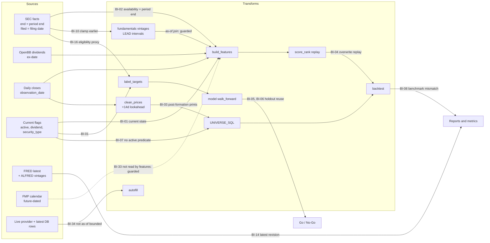

# Leakage Paths (Stage 1B)

| Field | Value |
|---|---|
| Stage | 1B — Bias and data integrity |
| Companion | `findings.md` (BI-), `bias-assessment.md` |
| Method | Trace every path from a source to a consumer and check whether the consumer can see information dated after its as-of date |
| Status key | **Open** = leak present; **Latent** = leak exists but not wired to production output; **Guarded** = control present and verified; **Unknown** = not verified |

## 1. Diagram of Information Flow

## 2. Path Register

| ID | Path | Direction of leak | Mechanism | Status | Evidence | Confidence | Type |
|---|---|---|---|---|---|---|---|
| LP-01 | SEC dividend period end → `d_declared` / `d_annual` → `dividend_yield`, `annual_dividend`, `dividend_growth` | Future figure visible before filing | `ex <= observation_date` with `ex = period end` | **Open** | `features.py:774-781, 858-868, 1116-1138` | 0.9 | Verified |
| LP-02 | SEC dividend period end → `earnings_payout` (via `annual`) | Same as LP-01 | Same annual figure | **Open** | `features.py:1282` | 0.85 | Verified |
| LP-03 | Fundamentals clamp `GREATEST(filed, period_end)` → quarterly availability | Rows visible before filing | Clamp moves availability to period end when `filed < period_end` | **Open** (limited rows) | `features.py:948-950, 1059-1060`; comment `:944-945` | 0.85 | Verified |
| LP-04 | Fundamentals vintages → as-of join | None | `LEAD` intervals give exactly one vintage per date | **Guarded** | `features.py:1018-1024, 1051-1053`; `fundamentals.py:87-105` | 0.9 | Verified |
| LP-05 | Fundamentals run ceiling | None | `period_end > as_of` excluded when `as_of` set | **Guarded** | `fundamentals.py:196-197`; `populate_fundamentals.py:294` | 0.9 | Verified |
| LP-06 | Future-dated periods (2039) | None | `V0078` deletes `period_end > CURRENT_DATE`; API as-of guard | **Guarded** | `tests/test_fundamentals_and_predictions.py:721-754`; `tests/test_api.py:79-102` | 0.9 | Verified |
| LP-07 | Annual fundamentals (`ANNUAL_SQL`) across vintages | Mixed or stale vintage (correctness) | `max()` across vintages | **Open** (correctness, not forward leak) | `portfolio.py:149-166` | 0.8 | Verified |
| LP-08 | Daily closes → features (momentum, volatility) | None | Trailing windows; `feature_window` anchor bounded by `as_of` | **Guarded** | `features.py:727-737, 1231-1242`; `feature_window.py:31-35` | 0.95 | Verified |
| LP-09 | Closes → forward return (label side) | None for features | `FOLLOWING` only in label-side forward return | **Guarded** | `returns.py:149`; `backtest.py:112-113` | 0.9 | Verified |
| LP-10 | Current universe flags → feature rows, labels, backtest | Survivorship (names that stopped are absent) | `active`, `dividend`, `security_type` evaluated today | **Open** | `populate_dividend_data.py:643-650`; `populate_fundamentals.py:59-63`; `feature_window.py:85,93`; `portfolio.py:91` | 0.9 | Verified |
| LP-11 | `UNIVERSE_SQL` without `active` predicate → live book | Inactive or mis-typed names selected | No `sec.active` predicate | **Open** | `portfolio.py:55-93` | 0.9 | Verified |
| LP-12 | Post-formation prices (+14d) → `clean_prices` → eligibility | Selection uses future prints | `prices_for(... end + 14 days)` | **Open** | `backtest.py:27, 88-95`; `portfolio.py:730-737, 753-761` | 0.8 | Verified |
| LP-13 | Post-formation prices → in-window returns | Not present: returns stop at `end` | `(start, end]` window | **Guarded** | `backtest.py:112-116` | 0.85 | Verified |
| LP-14 | Score replay → backtest history | Current policy applied to past dates; no as-produced record | Overwrite on `--as-of` | **Open** (research validity) | `score_rank.py:161-170, 267-290`; `schema.sql:1180-1187` | 0.8 | Verified |
| LP-15 | Score as-of date → feature window | None | Anchor cannot read future rows | **Guarded** | `feature_window.py:31-35, 73-77` | 0.95 | Verified |
| LP-16 | Label eligibility: XBRL proxies filed after as_of | Selection of training rows uses unpublished proxy | Eligibility counts any provider | **Open** | `label_targets.py:113-120` | 0.7 | Verified / Inferred |
| LP-17 | Label window | None | Outcome strictly after `as_of`; labels written after window | **Guarded** | `label_targets.py:55-56, 92-93, 121` | 0.9 | Verified |
| LP-18 | Purge in walk-forward | None | Training rows whose 365-day window closes before test start | **Guarded** | `model.py:337-342` | 0.95 | Verified |
| LP-19 | Scaler and imputer fitted per fold | None | `StandardScaler` and imputer inside Pipeline, fit on training rows | **Guarded** | `model.py:92-94, 406-407` | 0.95 | Verified |
| LP-20 | Threshold selection | None | Chosen from training predictions | **Guarded** | `model.py:408` | 0.9 | Verified |
| LP-21 | One holdout block reused for gate, guardrail, revisions | Forking paths (not fitting leak) | 50% tail split into four folds, reused | **Open** (governance) | `model.py:469-525`; `evaluate_walk_forward.py:233-270` | 0.85 | Verified |
| LP-22 | Gate criteria revised after fold results | Forking paths | `MIN_PR_AUC_LIFT` removed; `MAX_FLAG_RATE` added after GO | **Open** (governance) | `model.py:201-203, 219, 245-253`; `docs/data-health-workstreams.md:145-165` | 0.85 | Verified |
| LP-23 | Calendar tables (`raw.dividend_calendar`, `raw.upcoming_dividends`) → features or backtest | None today | No reader in `src/`, `app/`, `api/` | **Guarded** (by absence) | Stage 1B agent grep; `upcoming_dividends` uses `CURRENT_DATE` (latent if read in replay) | 0.9 | Verified |
| LP-24 | Macro latest revision → risk-free rate → Sharpe and backtest | Revised values used at historical dates | `RISK_FREE_SQL` reads `raw.macro_series` latest | **Open** (metrics only) | `portfolio.py:104-110, 615`; `backtest.py:166-167, 318` | 0.8 | Verified |
| LP-25 | ALFRED as-of path | None (correct) but unused | `DISTINCT ON ... vintage_date <= :as_of` | **Guarded** (unused) | `macro_vintages.py:16-23, 59-64` | 0.9 | Verified |
| LP-26 | Macro → scoring | None today | `read_macro_state` returns None | **Guarded** (by design) | `score_rank.py:16-30` | 0.9 | Verified |
| LP-27 | Analyst and consensus fields → model | None (not in model) | Absent from features, scores, labels | **Guarded** (by absence) | `features.py`, `scoring.py`, `model.py`, `label_targets.py` search | 0.85 | Verified |
| LP-28 | Analyst fields → worksheet autofill | Current estimates in a past-dated draft | Latest rows, live fetch | **Open** (research worksheet) | `analysis_autofill.py:585-604, 1695` | 0.75 | Verified / Inferred |
| LP-29 | Live provider → worksheet autofill | Current data in a past-dated draft | `fetch_company` live primary; `now()` default | **Open** (research worksheet) | `analysis_autofill.py:61, 546-549, 653` | 0.75 | Verified / Inferred |
| LP-30 | LLM draft generation | Not a new leak path beyond LP-28/29 | Optional, off by default, nothing written without review | **Guarded** (by design) | Stage 0 CMP-20; `app/views/investment_analysis.py` `_generate_section` | 0.9 | Verified |
| LP-31 | Analogs: conditions read as-of each historical date | None | Similarity compared on historical conditions | **Guarded** | `analogs.py` docstring lines 12-16 | 0.9 | Verified |
| LP-32 | Analogs: forward 12M windows monthly sampled | None (overlap control) | First observation date per month | **Guarded** | `analogs.py` docstring lines 22-28 | 0.9 | Verified |
| LP-33 | Analogs: industry classification current snapshot | Future classification applied to past dates | Documented limit | **Open** (documented) | `analogs.py` docstring lines 33-34 | 0.85 | Verified |
| LP-34 | Event study: current `common_stock` label | Classification as of today | Filter on current label | **Open** (low) | `scripts/event_study.py:25-30` | 0.6 | Verified |
| LP-35 | Price median over full history (price-quality) | Future price levels in historical classification | `percentile_cont` over all rows | **Open** (low) | `features.py:888-894` | 0.7 | Verified |
| LP-36 | Identity resolution `as_of` default | Non-reproducible replay | `as_of or date.today()` | **Open** (reproducibility) | `identity.py:53-66`; `sec_client.py:1465` | 0.9 | Verified |
| LP-37 | Raw SEC payload overwrite | Prior snapshot lost | Latest-only upsert | **Open** (auditability) | `schema.sql:650-658, 684-691`; `api/main.py:258-276` | 0.75 | Verified |
| LP-38 | Delisted names forward-filled | Zero return after delisting (upward bias) | `ffill` in `total_return_matrix` | **Latent** | `portfolio.py:325-330` | 0.75 | Verified |
| LP-39 | Validated baseline inverse-vol | Full-period volatility | `aligned.std()` over full window | **Latent** | `backtest.py:314-315` | 0.85 | Verified |
| LP-40 | Benchmark construction | Not leakage: exposure mismatch | 100% net-long benchmark vs 50% net book | **Open** (comparison validity) | `backtest.py:128-133`; `portfolio.py:281-290` | 0.8 | Verified |
| LP-41 | Execution at formation close | Optimistic execution | Score and trade at same close | **Open** (sensitivity) | `backtest.py:112-113` | 0.7 | Inferred |

## 3. Summary by Status

| Status | Count | IDs |
|---|---|---|
| Open | 21 | LP-01, 02, 03, 07, 10, 11, 12, 14, 16, 21, 22, 24, 28, 29, 33, 34, 35, 36, 37, 40, 41 |
| Latent | 2 | LP-38, LP-39 |
| Guarded | 18 | LP-04, 05, 06, 08, 09, 13, 15, 17, 18, 19, 20, 23, 25, 26, 27, 30, 31, 32 |
| Unknown | 0 | — |
| **Total** | **41** | Matches the 41 rows in §2 |

## 4. Highest-Priority Paths

1. LP-10 and LP-11: survivorship and unfiltered live book. Changes the selected names and every downstream metric.
2. LP-12 and LP-14: post-formation information in selection and non-archived scores.
3. LP-01 and LP-02: unpublished SEC dividend figures in features.
4. LP-21 and LP-22: holdout reuse and criteria revision. Blocks any clean out-of-sample claim.
5. LP-28 and LP-29: current data in past-dated research drafts.
