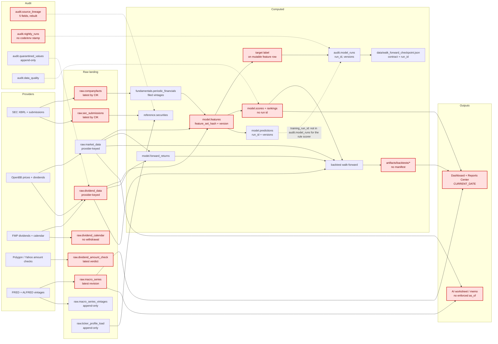

# Stage 1D Provenance Map

| Field | Value |
|---|---|
| Stage | 1D — Determinism and auditability |
| Scope | End-to-end lineage from providers to reports, and the identifiers that survive each hop |
| Method | Code/schema read plus SELECT-only probes; no writes |
| Repo HEAD | `d748cea` |
| Date | 2026-11-15 |

## 1. End-to-End Map

Solid arrows are implemented and queryable. Dashed arrows are missing, lossy, or only partially recorded. Red nodes mark a provenance break.



## 2. What Each Hop Records

| Hop | Identifier carried | Lost at the hop | Finding |
|---|---|---|---|
| Provider → raw | Provider name; `retrieved_at` on most rows | Provider request id; snapshot id | DA-03, DA-08 |
| Raw → fundamentals | `security_id`, `period_end`, `fiscal_period`, `filed` | Retrieval time of the payload version | DA-03 |
| Raw → features | `security_id`, `as_of_date`, `feature_set_hash`, `feature_version` | Input row ids; raw payload version | DA-12 |
| Features → label | `security_id`, `as_of_date` | Label run id, cutoff, label version | DA-16 |
| Features → scores | `security_id`, `as_of_date` | Feature hash/version, run id, scored-at | DA-02, DA-12 |
| Features → predictions | `run_id`, model/feature/data versions, config hash, training run id | Code SHA, data snapshot | DA-10 |
| Scores → backtest | `security_id`, `as_of_date` | Score run id; rule-set version; cost/benchmark definition | DA-09 |
| Backtest → artifact | Local timestamp filename | Run id, code SHA, data/config, benchmark, costs | DA-09 |
| Artifacts → dashboard | Newest complete filename set | Which code/rule set produced it | DA-09 |
| Runs → checkpoint | `run_id`, contract, versions, `generated_at` | Code/data/env hash; canonical file overwritten | DA-10, DA-18 |
| Runs → nightly | Nightly `run_id`, stage status | Code SHA, args, env, data snapshot | DA-11 |
| Any → lineage | `audit.source_lineage` for 5 fields | Model input lineage; prior lineage versions | DA-13 |

## 3. Trace Walkthroughs

### 3.1 “Why is security X in the 2024-06 book?”

1. `model.scores` gives the row for `(X, 2024-06-28)` — but it may have been re-scored later (DA-02).
2. `model.features` gives the inputs — unless the row was rebuilt after the fact (DA-12).
3. `raw.market_data` / `raw.dividend_data` give current values — unless dividends were overwritten (DA-05).
4. `fundamentals.periodic_financials` keeps filed vintages, so reported fundamentals are the strongest link.
5. `reference.securities` gives the current identity — ticker history is not closed by `valid_to` (DA-14).

**Result:** the computation is explainable from current inputs, but the *as-produced* state at 2024-06-28 is not provable.

### 3.2 “Can we regenerate the headline backtest?”

1. `artifacts/backtests/metrics_20261102_153616.json` has the metrics.
2. It names `price_filter=..._thin_v6`, which is not in the current code (`..._v5`).
3. The artifact has no run id, code SHA, data snapshot, cost, or benchmark definition.
4. The dashboard serves the newest complete timestamped set without checking code or rule-set compatibility.

**Result:** no. The artifact is evidence of a past run, not a reproducible result (DA-09, BI-21).

### 3.3 “Why did this dividend row lose its payment date?”

1. `raw.dividend_data` holds the current row; the prior value is gone.
2. `DIVIDEND_UPSERT` sets date columns to `EXCLUDED.*`, including NULL.
3. `audit.source_lineage` does not cover dividend dates; `raw.dividend_amount_check` covers amounts only.

**Result:** the current value is visible; the change is not. The only recovery path is an external backup (DA-05).

### 3.4 “Which acceptance policy judged this model run?”

1. `audit.model_runs` identifies the run and model/feature/data versions.
2. It does not store `acceptance_policy_version` or `generated_at`.
3. The canonical JSON checkpoint stores the contract, but only for the latest run and only until overwritten.
4. `contract_drift` can retire a mismatched checkpoint, but it cannot recover the policy for an older DB run.

**Result:** only the latest checkout/JSON pair is attributable; older DB runs are not (DA-10, DA-18).

## 4. Provenance Breaks

| Break | Consequence | Required fix | Finding |
|---|---|---|---|
| Score rows have no run id or version | Replays are indistinguishable from as-produced scores | Append-only score runs | DA-02 |
| Score rows lack feature hash/version | Cannot tie a score to the feature definition | Carry `feature_set_hash`/`feature_version`/`run_id` | DA-12 |
| SEC payloads are latest-only | Cannot rebuild what the model read | Append-only landing | DA-03 |
| Dividend dates/amounts overwrite | Cannot explain a changed date or amount | Preserve/append source values | DA-05, DA-06 |
| Backtest artifacts have no manifest | Cannot reproduce headline results | Immutable manifest per artifact | DA-09 |
| Run record omits policy/generated-at | Cannot attribute an older run to a policy | Persist full contract | DA-10 |
| Checkpoint overwritten | Only latest JSON evidence survives | One file per run + pointer | DA-18 |
| Lineage is delete/reinsert and narrow | Past provenance and model inputs absent | Append-only, broader lineage | DA-13 |
| Nightly has no code/env stamp | Cannot reproduce a nightly | Run manifest in nightly table | DA-11 |
| Reports use `CURRENT_DATE` | Past-dated report mixes current data | Explicit as-of + header stamp | DA-20 |
| Identity deletion is filesystem-archived | History not queryable or durable | Soft-delete with validity | DA-14 |
| Calendar has no withdrawal/version | Past calendar state unknown | Calendar snapshots | DA-15 |

## 5. Target Lineage (Stage 2 candidate)

```text
provider payload (append-only, retrieved_at)
  -> ingestion run (run_id, code_sha, args, data_snapshot)
  -> normalized row (source_row_id, run_id)
  -> feature row (feature_set_hash, feature_version, run_id)
  -> label row (label_run_id, cutoff, label_version)
  -> score row (run_id, feature_set_hash, feature_version, scored_at)
  -> prediction row (run_id, model_config_hash, training_run_id)
  -> backtest artifact (run_id, rule_set, cost/benchmark config, input snapshot)
  -> report (manifest_id, as_of, generated_at)
```

The invariant: **no row that a later stage reads may be overwritten without a new run id; no artifact may be served without the manifest that produced it.**
