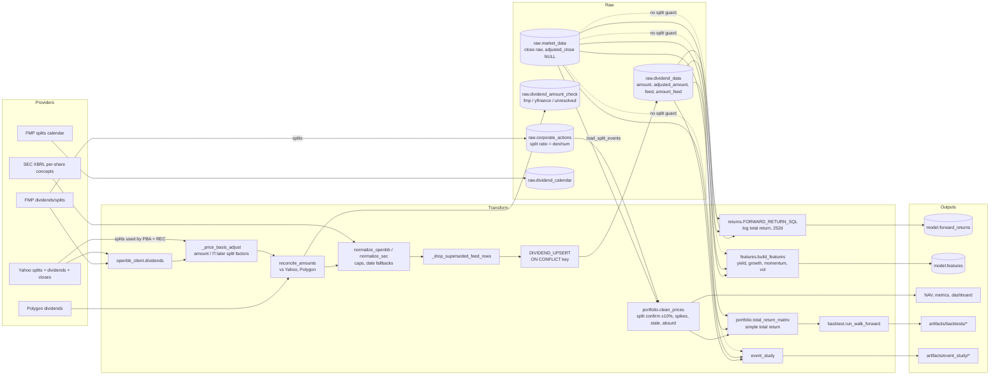

# Adjustment Lineage (Stage 1A)

| Field | Value |
|---|---|
| Stage | 1A — Price adjustment audit |
| Purpose | Trace how raw provider data becomes adjusted prices, dividends, and total returns |
| Type key | V = Verified (read), I = Inferred |

## 1. End-to-End Lineage

## 2. Lineage Table

| Stage | Input | Transform | Output | Adjustment applied | Type |
|---|---|---|---|---|---|
| L1 | FMP dividend row | `_fmp_dividends` → OpenBB model or direct REST | `amount` (declared), `adjDividend` | None at this step | V |
| L2 | Yahoo splits + dividends | `_yahoo_history` | split map, dividend list | None | V |
| L3 | FMP frame + Yahoo splits | `_price_basis_adjust` | `adjusted_amount = amount / Π later ratios` | Split restatement of dividend amount (replaces FMP `adjDividend`) | V |
| L4 | FMP + Yahoo + Polygon | `reconcile_amounts` | verdict and chosen amount; `amount_feed` | Replaces `amount` with Yahoo amount when Polygon confirms | V |
| L5 | Verdict cache | `_load_amount_checks` / `_save_amount_checks` | `raw.dividend_amount_check` | Cache, 7-day recheck for unresolved | V |
| L6 | Normalized rows | `normalize_openbb_dividend_rows` | row set | Drops > 1M; ex-date fallback to payment date | V |
| L7 | SEC XBRL | `normalize_sec_dividend_rows` | per-share rows, `ex = payment = period end` | No restatement (`adjusted_amount` None) | V |
| L8 | Row set | `_drop_superseded_feed_rows` + `DIVIDEND_UPSERT` | `raw.dividend_data` | Overwrite on key | V |
| L9 | Split events | `load_corporate_actions` / `fetch_fmp_splits` | `raw.corporate_actions` (`ratio = den/num`) | Stored, not applied | V |
| L10 | Closes + splits | `portfolio.clean_prices` | cleaned closes | Split factor applied where confirmed within ±10% and 5 days | V |
| L11 | Cleaned closes + dividends | `total_return_matrix` / `FORWARD_RETURN_SQL` | total return series | Dividend credited on first priced row ≥ ex-date | V |
| L12 | Returns | `portfolio_returns`, `performance_metrics`, `risk_metrics` | NAV, Sharpe, VaR | None further | V |
| L13 | Closes + dividends | `features.build_features` | `model.features` | Uses raw close and `COALESCE(adjusted_amount, amount)`; no split guard | V |
| L14 | Events | `event_study` | AR, CAR | `|r|>0.5` blanked; no split guard | V |

## 3. Date Semantics Along the Lineage

| Date | Used by | Meaning | Gap |
|---|---|---|---|
| `ex_dividend_date` (OPENBB) | Dividend credit, features, event study | Ex-date | Falls back to payment date if missing (PA-D04) |
| `ex_dividend_date` (SEC) | Features fallback | Fiscal period end | Not an ex-date; filing date dropped (PA-D01, PA-D02) |
| `observation_date` (market) | All price logic | Trading date | Cash-period index uses weekdays (PA-P08) |
| Split event `effective_date` | `clean_prices` (±5 days) | Split date | Real moves >10% on split day not adjusted (PA-P01, PA-P02) |
| Formation date | Backtest selection | Score date | Selection uses prices to end + 14 days (PA-P05) |

## 4. Lineage Gaps (summary)

1. Splits are applied to closes in one place only (`clean_prices`). Return, feature, and event paths read unadjusted closes.
2. `adjusted_close` is documented as NULL and no code path computes a stored adjusted series. Adjustment is recomputed per caller.
3. Dividend restatement uses split knowledge at ingestion time, not as-of the valuation date.
4. Provenance of the price series is collapsed to `provider = 'OPENBB'` (Stage 0 DF-F02), so the split basis of closes cannot be audited per row.
